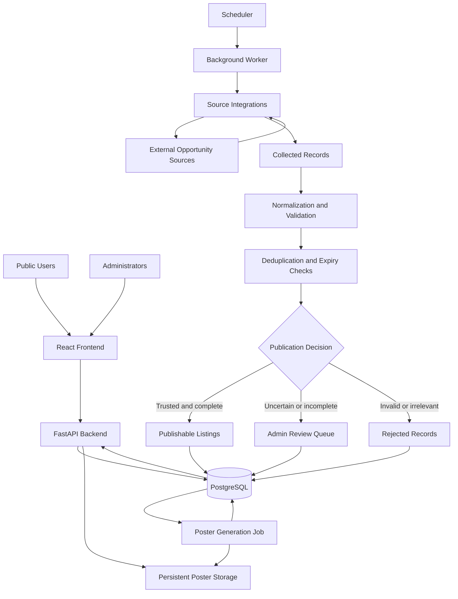

# Kodely System Architecture

**Document version:** 0.1  
**Status:** Proposed architecture  
**Project stage:** 1, Planning and Specification

## 1. Purpose

This document describes the proposed technical structure of Kodely, including the frontend, backend API, PostgreSQL database, source collection system, data-quality pipeline, poster generator, administration workflow, and deployment environment.

The architecture should support incremental development, reliable data processing, and expansion from Kenya to broader African coverage.

## 2. Architecture Principles

1. **Modularity:** Source integrations and application components should be independently maintainable.
2. **Data integrity:** Listings should be validated before they become public.
3. **Traceability:** Each listing should retain its source references and verification history.
4. **Conservative automation:** Uncertain records should be routed to manual review.
5. **Deployment readiness:** Configuration, database migrations, logging, and health checks should be planned from the beginning.
6. **Separation of responsibilities:** The user interface, API, collection jobs, and database should have clearly defined roles.
7. **Responsible collection:** Integrations must respect source access restrictions, rate limits, and applicable rights.
8. **Incremental growth:** New sources, categories, and countries should not require rebuilding the entire application.

## 3. High-Level System Diagram



This is a logical overview. The initial deployment may run multiple components in the same environment, while still keeping their responsibilities separate.

## 4. Main Components

### 4.1 React Frontend

The frontend provides the public discovery experience and the administrative interface.

Responsibilities:

- Display opportunity listings and detail pages.
- Support search, filtering, and pagination.
- Provide category, country, and Kenya county filters.
- Display participation mode separately from eligibility.
- Show known deadlines, fees, rewards, and organizer details.
- Link to original announcements and registration pages.
- Provide administrative screens for reviewing and managing listings.
- Handle loading, empty, error, and expired-listing states.
- Support responsive layouts and accessible interactions.

Proposed tools: React, Vite, and Tailwind CSS.

### 4.2 FastAPI Backend

The backend exposes the application API and enforces core application rules.

Responsibilities:

- Retrieve opportunity records from PostgreSQL.
- Apply search, filtering, sorting, and pagination.
- Provide opportunity detail and category information.
- Validate administrative edits and publication actions.
- Enforce access controls on administrative endpoints.
- Return consistent errors and appropriate HTTP status codes.
- Expose health information for operational monitoring.
- Coordinate access to poster metadata and persistent assets.

Scrapers and scheduled workers should not depend on public frontend routes to perform their work.

### 4.3 PostgreSQL Database

PostgreSQL is the primary persistent store for structured application data.

Proposed data entities include:

- **Opportunity:** Main listing information.
- **Source:** An external source and its configuration metadata.
- **OpportunitySource:** The relationship between a listing and one or more source records.
- **Category:** Configurable opportunity categories.
- **Country:** Country-level geographic information.
- **County:** Kenyan county information.
- **PosterAsset:** Generated graphic metadata and storage references.
- **CollectionRun:** Outcome and timing of source collection jobs.
- **ReviewAction:** Administrative decisions and relevant audit information.

These are initial logical entities. The final schema, field types, constraints, and relationships will be defined during Stage 4.

PostgreSQL should enforce appropriate constraints and indexes. Alembic migrations will provide a repeatable way to evolve the schema.

### 4.4 Source Integration Layer

Each external source should have an independent integration module.

Responsibilities:

- Retrieve opportunity information using an appropriate permitted method.
- Parse source-specific content.
- Extract source URLs and relevant fields.
- Handle timeouts, temporary failures, and rate limits.
- Report collection outcomes.
- Avoid coupling source-specific parsing logic to the frontend or API.

Preferred collection methods, in order where practical:

1. Official APIs.
2. Official feeds or structured data.
3. Permitted HTML parsing.
4. Browser automation when necessary and permitted.

A source's availability, reliability, terms, and technical limitations must be assessed before integration.

### 4.5 Background Worker and Scheduler

Background jobs handle tasks that should not run inside ordinary user requests.

Responsibilities may include:

- Collecting new listings.
- Retrying recoverable collection failures.
- Normalizing and validating records.
- Detecting duplicates.
- Checking deadlines and listing expiry.
- Generating or regenerating posters.
- Recording job outcomes.
- Performing scheduled maintenance.

The scheduler triggers jobs; the worker executes them. The initial implementation may use a simple scheduled process, with a more advanced task queue introduced if operational needs justify it.

Jobs should be designed to be idempotent where possible. Re-running a job should not create duplicate listings or duplicate side effects.

### 4.6 Data Quality Pipeline

Collected records pass through a common processing pipeline:

1. **Collect:** Retrieve source content.
2. **Extract:** Convert source content into structured fields.
3. **Normalize:** Standardize dates, URLs, locations, categories, and text.
4. **Validate:** Check required fields, consistency, and source references.
5. **Deduplicate:** Compare against existing listings and source records.
6. **Check status:** Identify expired deadlines or closed opportunities.
7. **Decide:** Determine whether to publish, review, or reject.
8. **Persist:** Store the record and its provenance.
9. **Generate assets:** Create or update the poster when appropriate.

Validation rules should distinguish missing data from invalid data. An unknown entry fee, for example, is not the same as a confirmed zero entry fee.

### 4.7 Publication and Review Workflow

The publication decision should use explicit, configurable rules.

**Automatic publication**

A listing may be published automatically when its source is sufficiently trusted, its important fields pass validation, its source references are available, and there are no unresolved conflicts.

**Manual review**

A listing should enter the review queue when it has uncertain dates, conflicting source details, questionable eligibility information, low-confidence extraction, or other configured warning conditions.

**Rejection or exclusion**

Invalid, irrelevant, clearly duplicated, or untrustworthy records should be excluded from public publication. Rejection should not silently erase useful provenance or audit history.

The exact publication thresholds will be defined and tested during implementation.

### 4.8 Poster Generation and Storage

The poster generator produces original Kodely-branded promotional graphics from validated listing data.

Responsibilities:

- Apply reusable visual templates.
- Display only supported, reliable fields.
- Handle long titles and missing optional information.
- Use consistent typography, spacing, and branding.
- Produce output suitable for web and social sharing.
- Save generated files in persistent storage.
- Record poster dimensions, format, generation time, and associated listing.
- Regenerate assets when relevant listing information changes.

The database should store poster metadata and a storage reference rather than relying on temporary local files.

Third-party logos and imagery should only be included when their use is permitted.

### 4.9 Administrative Interface

Administrators will use protected screens to:

- Review uncertain listings.
- Inspect source references and validation warnings.
- Correct inaccurate fields.
- Approve, reject, publish, or unpublish listings.
- Resolve duplicates.
- Inspect collection job status.
- Regenerate posters.
- Review relevant changes and administrative actions.

Authentication and authorization must be implemented before administrative functions are exposed in production.

## 5. Proposed Data Flow

### 5.1 Collection to publication

1. The scheduler starts a collection job.
2. The worker runs the configured source integrations.
3. Integrations return structured candidate records.
4. The pipeline normalizes and validates each candidate.
5. Duplicate and expiry checks run.
6. The publication rules select automatic publication, manual review, or rejection.
7. The result and source provenance are persisted in PostgreSQL.
8. Eligible published listings are sent for poster generation.
9. The frontend retrieves published listings through the API.

### 5.2 User discovery

1. A user opens the React application.
2. The frontend requests listing data from FastAPI.
3. The API validates the requested filters.
4. PostgreSQL returns matching published listings.
5. The frontend displays the results.
6. The user opens a detail page and follows the original source or registration link.

### 5.3 Administrative review

1. An administrator signs in.
2. The interface requests records awaiting review.
3. The administrator inspects the extracted data, source references, and warnings.
4. The administrator corrects or decides the listing's status.
5. The backend validates and records the action.
6. Published changes become available through the public API.
7. Relevant poster assets are generated or refreshed.

## 6. Initial Logical Repository Structure

The following structure is proposed. It will be adjusted as the application develops.

```text
kodely/
├── backend/
│   ├── app/
│   │   ├── api/
│   │   ├── core/
│   │   ├── db/
│   │   ├── models/
│   │   ├── schemas/
│   │   ├── services/
│   │   └── main.py
│   ├── scrapers/
│   │   ├── base.py
│   │   └── sources/
│   ├── jobs/
│   ├── posters/
│   ├── tests/
│   ├── alembic/
│   └── requirements.txt
├── frontend/
│   ├── public/
│   └── src/
│       ├── components/
│       ├── pages/
│       ├── features/
│       ├── services/
│       └── styles/
├── docs/
│   ├── PROJECT_SPECIFICATION.md
│   ├── ROADMAP.md
│   ├── ARCHITECTURE.md
│   └── DATA_SOURCES.md
├── .env.example
├── .gitignore
├── compose.yaml
└── README.md
```

This is a target structure, not a requirement to create every directory immediately.

## 7. Security and Configuration

- Store credentials and secrets in environment variables or an appropriate secrets manager.
- Commit an example environment file containing placeholders only.
- Do not commit real credentials, private keys, or production database URLs.
- Restrict administrative routes using authentication and authorization.
- Validate and constrain incoming API data.
- Configure database access using least privilege.
- Apply request limits and safe error handling where appropriate.
- Keep dependencies maintained and review security advisories.
- Restrict access to logs that may contain sensitive operational information.

## 8. Reliability and Observability

The application should provide:

- Structured application and job logs.
- Collection run status and failure summaries.
- Health checks for critical services.
- Timeouts and bounded retries for external requests.
- Safe handling of partial failures.
- Database migrations that can be applied reproducibly.
- Persistent storage for required assets.
- Documented backup and restoration procedures.
- Tests for critical data-quality and publishing rules.

A failed source integration should not prevent unrelated sources from running.

## 9. Deployment Model

The proposed production environment contains:

- A React frontend served through a suitable web hosting or static delivery service.
- A FastAPI application service.
- A PostgreSQL database.
- A background worker and scheduler.
- Persistent storage for generated posters.
- Environment-based configuration and secret management.

Docker-compatible configuration should make local services and deployment more reproducible. The final hosting provider and service topology will be selected before production deployment.

The production setup must account for persistent data, scheduled jobs, backups, migrations, HTTPS, logs, and health checks.

## 10. Key Architectural Decisions Still to Finalize

- Whether the first deployment uses one combined worker process or separate worker and scheduler services.
- Which persistent poster-storage service will be used.
- Which authentication mechanism will protect administration.
- Which hosting provider and deployment topology will be selected.
- Which initial source integrations offer sufficient value and reliable access.
- Whether job volume justifies a dedicated task queue.
- The final schema and rules for linking duplicate records from different sources.

These decisions should be made when the relevant implementation requirements are clearer, rather than adding unnecessary infrastructure prematurely.

## 11. Architecture Acceptance Criteria

The architecture is ready to guide implementation when:

- Component responsibilities are clear.
- The proposed data flow is documented.
- Source collection is separated from request handling.
- Publication and review paths are defined.
- Persistent database and asset storage are accounted for.
- Security and operational requirements are included.
- Outstanding decisions are recorded explicitly.

**Next step:** Complete the data-source strategy, review all Stage 1 documents together, and then begin UI/UX design.